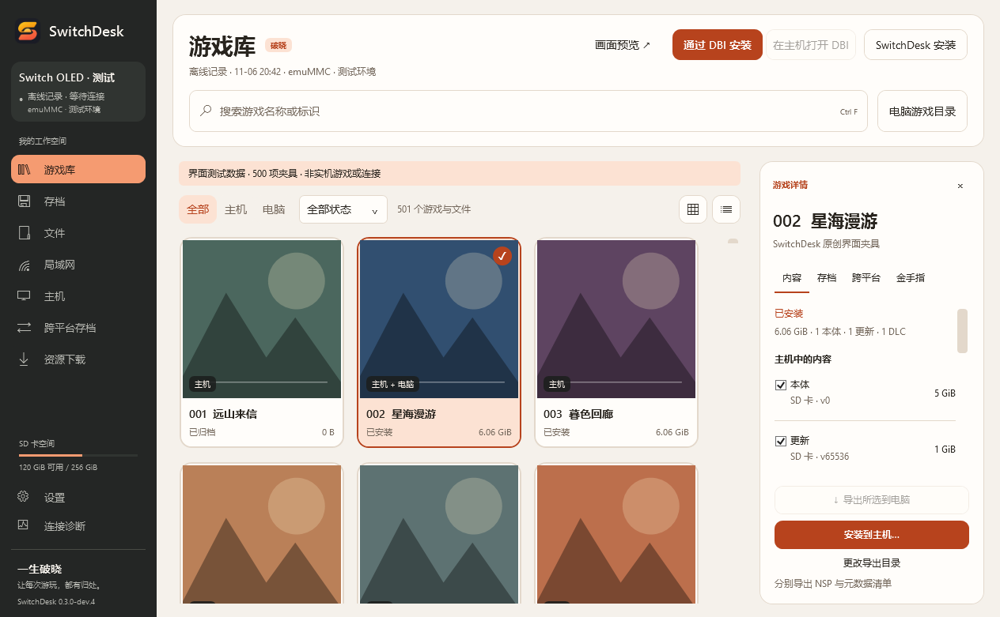

  <h1>SwitchDesk · Dawn</h1>
  
Manage your games, saves and files

  
<a href="https://github.com/yishengpoxiao/SwitchDesk/releases">Downloads</a> · <a href="docs/BUILD.md">Build &amp; setup</a> · <a href="docs/STATUS.md">Validation &amp; limits</a> · <a href="README.md">简体中文</a>

Maintained by **一生破晓** ([yishengpoxiao](https://github.com/yishengpoxiao)), based on [Humboldt-Zh/SwitchDesk](https://github.com/Humboldt-Zh/SwitchDesk). Licensed under [GPL-3.0](LICENSE); original and [third-party credits](THIRD-PARTY-NOTICES.md) are retained.

A warm orange / graphite interface with the Dawn icon. This update fixes long download filenames, FTP synchronization after cancellation and dependency download retries, and improves resource-search cancellation and error messages.

<picture>
  <source media="(prefers-color-scheme: dark)" srcset="docs/images/library-dark.png">
  
</picture>

Features include game libraries, save backups, SD / FTP file management, resource downloads, and DBI / SysDVR integration. Windows has a desktop UI; macOS has a CLI. Detailed guides and the UI are in Chinese.

**0.3.0-dev.4 is a development preview.** Verify `SHA256SUMS.txt`, extract the Windows package and run `SwitchDesk.exe`. The Switch companion requires Atmosphère. Cross-platform save migration is not enabled; native HOME hiding remains disabled. This edition has not undergone hardware acceptance; see [validation status](docs/STATUS.md). Releases include matching corresponding source and hashes.
