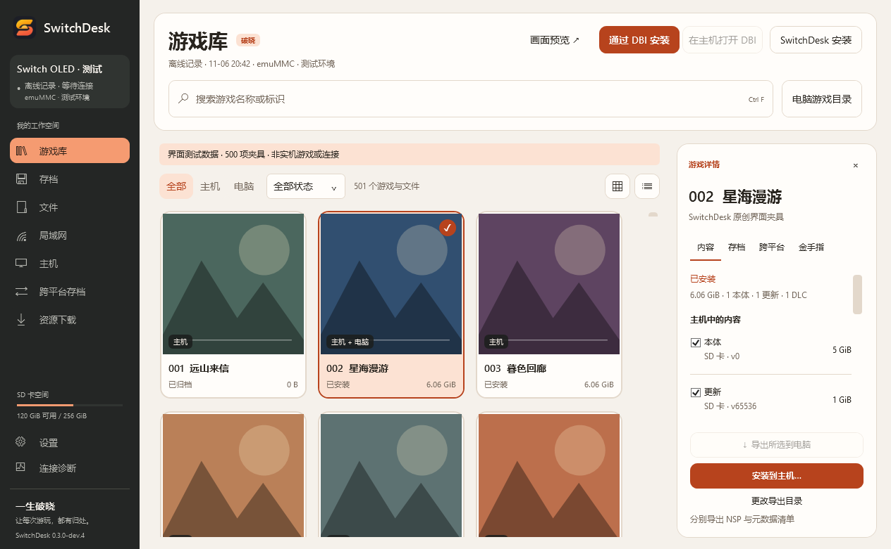

  <h1>SwitchDesk · 破晓</h1>
  
游戏、存档与文件管理工具

  
<a href="https://github.com/yishengpoxiao/SwitchDesk/releases">下载安装包</a> · <a href="docs/BUILD.md">构建与使用</a> · <a href="docs/STATUS.md">验证与限制</a> · <a href="README.en.md">English</a>

由 **一生破晓**（[yishengpoxiao](https://github.com/yishengpoxiao)）基于 [Humboldt-Zh/SwitchDesk](https://github.com/Humboldt-Zh/SwitchDesk) 改进，采用 [GPL-3.0](LICENSE)，保留原项目及[第三方署名](THIRD-PARTY-NOTICES.md)。

采用暖橙／石墨界面与“破晓”图标。本次修复长文件名下载、FTP 取消后的连接同步及依赖下载重试，改善资源搜索取消和错误提示，保留精简文档。

<picture>
  <source media="(prefers-color-scheme: dark)" srcset="docs/images/library-dark.png">
  
</picture>

支持游戏库整理、存档备份、SD／FTP 文件管理、资源下载，以及 DBI 和 SysDVR 入口。Windows 提供桌面端，macOS 提供命令行端。

**0.3.0-dev.4 为开发预览。** 下载后核对 `SHA256SUMS.txt`，Windows 解压运行 `SwitchDesk.exe`；Switch 配套需要 Atmosphère。跨平台存档迁移尚未开放，原生 HOME 隐藏关闭；本轮未做真机验收，具体范围见[状态说明](docs/STATUS.md)。发布包附匹配源码与校验摘要。
